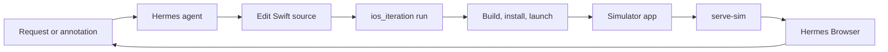

# Hermes-iOS-sim

Build and visually iterate on native iOS apps inside Hermes Desktop. Select an Xcode project and Simulator, build the real app, and inspect it in Hermes Browser. Annotated feedback guides source edits and another native build.

**Served through localhost.** The pinned preview dependency has a known unresolved Host-validation issue. Use only on a trusted local Mac. Never expose, forward, or tunnel the preview port. Localhost does not prevent access by other local processes or eliminate malicious-browser risks. Remediation is deferred for this release; see the [security audit](docs/security-audit.md).

This is a community plugin, not an official Nous Research product or a catalog-admitted integration. It controls a trusted local Mac. No minimum compatible Hermes release is established. Read [release status](plugin/RELEASE-STATUS.md) and [security limits](SECURITY.md) before installation.

## What you get

- `ios_setup` checks prerequisites and provisions the pinned preview dependency through host approval.
- `ios_iteration` discovers targets, optionally builds and launches apps, and manages owned previews.
- The bundled `hermes-ios:ios-development` skill guides the agent through editing and verification.
- Optional Desktop controls open with **⌘K → Open Hermes-iOS-sim controls**.

The agent edits actual project files. Xcode builds the application. The preview streams the running Simulator, rather than drawing a replacement interface. Browser, annotations, ordinary Send, and image inspection belong to Hermes.



## Prerequisites

Use a trusted local Mac with Hermes Desktop, Xcode with license and first-launch setup complete, an installed iOS Simulator runtime, Node.js 20 or newer, and npm. The agent needs an authorized app checkout and an exact project, scheme, configuration, runtime, and simulator UDID.

Dependency setup requires direct access to `registry.npmjs.org`. The npm subprocess does not inherit proxy variables or custom registry settings. The separate Python archive verifier can use environment or system proxies; it still verifies locked archive integrity. Bun and Python development dependencies are needed only to work on this repository.

**Do not expose or tunnel the preview port.** The pinned dependency provides unauthenticated simulator streaming and control routes. Loopback is not an authorization boundary. Build scripts and downloaded native dependencies execute with your account's permissions. This plugin is not a sandbox.

## Install

Read the security warning above before installing. Use the immutable commit and command in the [release notes](https://github.com/akinduroifedayo/Hermes-iOS-sim/releases/tag/v1.0.0). The public source repository is [Hermes-iOS-sim](https://github.com/akinduroifedayo/Hermes-iOS-sim).

## Install from a trusted checkout

Use the intended Hermes profile for both the CLI and Desktop. Inspect the checkout and select a trusted committed revision before running these commands from its root:

```sh
REVISION="$(git rev-parse --verify HEAD)"
hermes plugins install "file://$(pwd -P)#plugin" --ref "$REVISION" --no-enable
hermes plugins doctor hermes-ios --ci
hermes plugins enable hermes-ios
```

Enable the managed Desktop component in **Hermes Desktop → Plugins**. If the current chat lacks the tools, start a chat that exposes the new registration and load `hermes-ios:ios-development`. Do not copy a second same-ID Desktop plugin beside the managed copy.

Ask the agent to check preflight and call `ios_setup(action="provision")` if the preview dependency is missing. Provisioning requires normal approval. No global npm installation is required.

Use the published release notes for the immutable revision and artifact checksums. See [operations](docs/operations.md) for pinned updates, rollback, and removal.

## Run your first app session

Tell the agent which checkout it may use:

> Build this iOS app in the Simulator and show it in Hermes Browser. Discover schemes and available devices first. Preserve app data and use normal build approval.

The workflow is:

1. Discover an exact target and check prerequisites.
2. Build, install, and launch through Xcode tooling or the approved `ios_iteration` coordinator.
3. Start or reuse the selected simulator's preview and open the returned URL with `desktop_preview`.
4. Inspect the actual app. Annotate in Browser and press ordinary **Send**.
5. Have the agent inspect the submitted image, edit the source, rebuild, and verify the changed app.
6. Use explicit **Stop** when owned work should end. Stop can terminate the coordinator-owned app as well as its preview service. It does not erase app data or simulator devices.

Closing Browser only closes the view. A ready server, a successful open request, and observed app pixels are different results. The preview process may restart during a rebuild; the same URL does not guarantee uninterrupted streaming.

## Documentation

- [Architecture and tool flow](docs/architecture.md).
- [Operations and troubleshooting](docs/operations.md).
- [Reusable app cards](docs/contextual-cards.md).
- [Security policy](SECURITY.md).
- [Development and contribution guide](CONTRIBUTING.md).
- [Release status and known limitations](plugin/RELEASE-STATUS.md).
- [Bundled skill dependencies](docs/skill-distribution.md).

## Repository layout

| Path | Purpose |
| --- | --- |
| `plugin/` | Installable backend, Desktop bundle, skill, dependency lock, and notices |
| `src/desktop/` | Editable Desktop source |
| `src/shared/` | Shared identity definitions |
| `scripts/` | Verification, packaging, and isolated qualification helpers |
| `tests/` | Backend, Desktop, integration, privacy, and contract tests |
| `fixtures/VisualIterationFixture/` | Optional Xcode test app |

## Development

Follow [CONTRIBUTING.md](CONTRIBUTING.md) to create the Python test environment. Then run:

```sh
bun install --frozen-lockfile --ignore-scripts
bun run verify
bun run package:release -- --output ../hermes-ios-package
```

Use a new package output directory. The packager reads current checkout bytes and updates the committed Desktop bundle from its build output. Review the diff before publishing. Local test success is not proof of installed Desktop behavior or security of downloaded native binaries.

## License

Original project code uses the [MIT license](LICENSE). Third-party components retain their own licenses and attribution. `serve-sim` is Apache-2.0. The plugin archive contains its dependency lock, not downloaded npm payloads or Apple runtimes. See [third-party notices](plugin/THIRD-PARTY-NOTICES.md).
