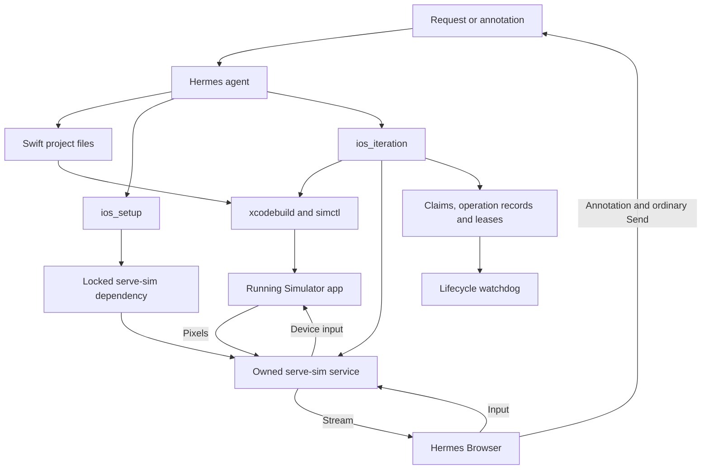
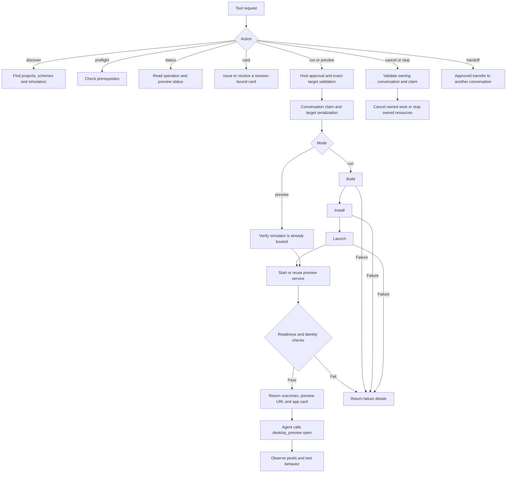

# Architecture and iteration flow

The agent edits actual source files. The plugin coordinates Apple tooling and a preview service. Hermes owns the Browser pane, annotations, and image inspection.

## Components

## `ios_iteration` actions

`run` builds, installs, and launches. `preview` does none of those and does not boot a simulator. Both can return a preview URL, but the agent must call the separate `desktop_preview` host tool to open the pane.

Source editing happens outside `ios_iteration`. Cards send a request into chat; a card click does not bypass normal approval. Stop can terminate a coordinator-owned app as well as its preview service.

## Results that must stay separate

A successful native build does not establish preview readiness. Preview readiness does not establish displayed pixels. Displayed pixels do not establish that input reaches the app. An unchanged URL does not establish uninterrupted server lifetime.

See [operations](operations.md) for action parameters, lifecycle behavior, and failure codes. These diagrams are conceptual maps, not exhaustive call graphs.
